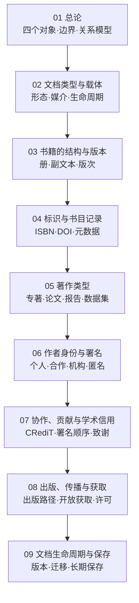

# 🗺️ 文档与著作知识地图

> `002` 文档、书籍、著作、著作人子库的**内容地图（MOC）** —— 主线导航 + 章节目录 + 读法。**九章已全部落笔**，待人工复核与编译。
> 入口：[[002-文档、书籍、著作、著作人|002 文档、书籍、著作、著作人]] · Schema：[[3 Resources/000-Knowledge/00-总类/002-文档、书籍、著作、著作人/CLAUDE|CLAUDE]]

## 主线

## 章节目录

| # | 章节 | 主线 | 状态 |
|:-:|:--|:--|:--:|
| 01 | [[3 Resources/000-Knowledge/00-总类/002-文档、书籍、著作、著作人/raw/articles/01-文档与著作总论/01-文档与著作总论\|文档与著作总论]] | 四个对象 · 文档边界 · 书与文本 · 作品同一性 · 作者功能 | ✅ 落笔 |
| 02 | [[3 Resources/000-Knowledge/00-总类/002-文档、书籍、著作、著作人/raw/articles/02-文档类型与载体/02-文档类型与载体\|文档类型与载体]] | 多轴类型 · 载体形态 · 原生数字 / 数字化 · 记录与档案 · 生命周期 | ✅ 落笔 |
| 03 | [[3 Resources/000-Knowledge/00-总类/002-文档、书籍、著作、著作人/raw/articles/03-书籍的结构与版本/03-书籍的结构与版本\|书籍的结构与版本]] | 三层结构 · 物理解剖 · 副文本 · 书目要素 · 版次与印次 · 版本谱系 | ✅ 落笔 |
| 04 | [[3 Resources/000-Knowledge/00-总类/002-文档、书籍、著作、著作人/raw/articles/04-标识与书目记录/04-标识与书目记录\|标识与书目记录]] | 标识六属性 · 对象层级 · ISBN / ISSN / ISMN / DOI · 持久标识 · 责任者标识 · 书目记录 | ✅ 落笔 |
| 05 | [[3 Resources/000-Knowledge/00-总类/002-文档、书籍、著作、著作人/raw/articles/05-著作类型/05-著作类型\|著作类型]] | 四轴分类 · 期刊 / 会议 / 专著 / 编著 · 学位论文 · 灰色文献 · 数据与软件 · 版本链 | ✅ 落笔 |
| 06 | [[3 Resources/000-Knowledge/00-总类/002-文档、书籍、著作、著作人/raw/articles/06-作者身份与署名/06-作者身份与署名\|作者身份与署名]] | 署名五功能 · 作者类型 · ICMJE 四条 · 贡献序 / 字母序 · 机构与集体署名 · 匿名 · AI 署名 | ✅ 落笔 |
| 07 | [[3 Resources/000-Knowledge/00-总类/002-文档、书籍、著作、著作人/raw/articles/07-协作、贡献与学术信用/07-协作、贡献与学术信用\|协作、贡献与学术信用]] | 团队科学 · CRediT 14 角色 · 作者 / 贡献者模型 · 致谢 · 信用计量 · 信用分配 · 不端与责任 | ✅ 落笔 |
| 08 | [[3 Resources/000-Knowledge/00-总类/002-文档、书籍、著作、著作人/raw/articles/08-出版、传播与获取/08-出版、传播与获取\|出版、传播与获取]] | 出版链 · 订阅 / OA 经济 · 金 / 绿 / 钻石 / 青铜 · CC 许可 · 评议类型 · 传播层次 · 获取三重门槛 | ✅ 落笔 |
| 09 | [[3 Resources/000-Knowledge/00-总类/002-文档、书籍、著作、著作人/raw/articles/09-文档生命周期与保存/09-文档生命周期与保存\|文档生命周期与保存]] | 生命周期 / 连续体 · 版本追溯 · 威胁模型 · 迁移 / 仿真 / 封装 · OAIS / TDR · 备份 · 真实性 · 鉴定处置 · 全库收束 | ✅ 落笔 |

## 两条读法

1. **对象线（是什么 → 怎么标识 → 怎么分类）**：01 → 02 → 03 → 04 → 05 —— 回答「文档、书、著作分别是什么，如何被识别与归类」。
2. **责任线（谁写的 → 怎么协作 → 怎么流通 → 怎么留存）**：06 → 07 → 08 → 09 —— 回答「谁对文本负责，作品如何进入公共世界并被保存」。

## 与其他库的分工

| 问题 | 去向 |
|:--|:--|
| 文献怎么著录成目录（ISBD / MARC / FRBR） | [[3 Resources/000-Knowledge/01-目录学/01-目录学\|01 目录学]] |
| 信息怎么组织与检索（分类法 / 元数据标准） | [[3 Resources/000-Knowledge/02-信息学/02-信息学\|02 信息学]] |
| 知识怎么传播（科普 / 科学传播） | [[001-科学与知识总论、智力工作组织\|001 科学总论]]（001.9） |
| 出版产业与编辑实务 | 暂缺库（CLC `G23` 域） |

## 关联

- 父级子库：[[3 Resources/000-Knowledge/00-总类/00-总类|000 总类]]
- 同层子库：[[001-科学与知识总论、智力工作组织|001 科学总论]] · [[005-管理|005 管理]]
- Wiki 索引：[[3 Resources/000-Knowledge/00-总类/002-文档、书籍、著作、著作人/wiki/index|002 Wiki 索引]]
