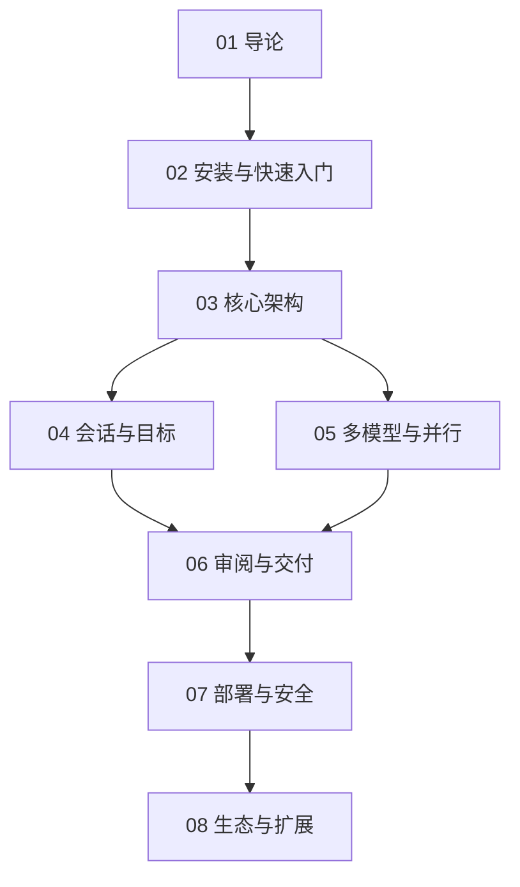

# OpenChamber 知识地图

## 分层学习路线

| 层级 | 能力 | 对应章节 |
|:--:|------|:--:|
| L1 | 说清 ADE 与 IDE / runtime 的边界 | 01 |
| L2 | 任选一条路径安装并跑通首个会话 | 02 |
| L3 | 理解实例模型、服务端职责与远程链路 | 03 |
| L4 | 用 Session Goals 把提示词变成可终止的循环 | 04 |
| L5 | 用 Multi-run + worktree 做并行采样与隔离 | 05 |
| L6 | 审阅大 diff、把运行中的应用变成上下文、完成交付 | 06 |
| L7 | 自托管、配对、企业策略与安全边界 | 07 |
| L8 | 扩展 agent 的模型、工具、面板与自动化 | 08 |

## 五条主线

| 主线 | 内容 | 章节 |
|------|------|:--:|
| **控制面** | 实例 → 服务端 → 客户端；状态在服务端，视图可替换 | 03 |
| **目标线** | Session Goal → 审计器 → 继续/完成/受阻 → 安全上限 | 04 |
| **并行线** | Multi-run → 独立 worktree → 择优 / Fusion | 05 |
| **审阅线** | Changes Walkthrough → Preview 标注 → CI 回传 → 合并 | 06 |
| **治理线** | UI 密码 / 设备令牌 → Private Relay → 企业策略 | 07 |

## 概念速查

| 概念 | 一句话 | 章节 |
|------|--------|:--:|
| **ADE** | Agentic Development Environment：管理 agent 会话而非编辑代码 | 01 |
| **Instance** | 跑在你掌控机器上的服务进程；会话归属其所有 | 03 |
| **Session Goal** | 带独立审计与终止条件的持久循环 | 04 |
| **Multi-run** | 同一任务并行交给多个模型 | 05 |
| **Fusion** | 把多个 run 的最强部分合成一个新会话（产品自述，机制未公开） | 05 |
| **Worktree Session** | 独立分支 + 独立目录的隔离会话 | 05 |
| **Changes Walkthrough** | 把 diff 重排为有解释的顺序步骤，不做质量评判 | 06 |
| **Private Relay** | 端到端加密的盲转发，不开放入站端口 | 07 |
| **Loop** | 以 Markdown 提交的 cron 任务，默认关闭 | 08 |
| **Extension** | OpenChamber 的 UI 扩展，按权限清单授权；≠ OpenCode plugin | 08 |

## 三个最容易混淆的边界

| 混淆点 | 正确理解 |
|--------|---------|
| OpenChamber vs OpenCode | 前者是控制面/工作台，后者是执行运行时 |
| Extensions vs OpenCode plugins | 前者是 OpenChamber 的右栏面板；后者运行在 OpenCode 内 |
| Claude Code 集成 vs 纳管 Claude Code | 前者只把 Claude 订阅接入为模型 provider；工具执行仍在 OpenCode |

## 关联

- 子库主页：[[3 Resources/000-Knowledge/raw/articles/004.8-OpenChamber/004.8-OpenChamber|004.8 OpenChamber]]
- 上游：[[3 Resources/000-Knowledge/raw/articles/004.8-OpenCode/004.8-OpenCode|004.8 OpenCode]]
- 来源：[[3 Resources/000-Knowledge/raw/articles/004.8-OpenChamber/wiki/sources/source-OpenChamber-README|source-OpenChamber-README]]
