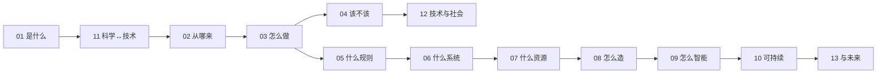

# 技术知识地图

> [[3 Resources/600-Technology/600-Technology|600 技术（UDC 6 · 应用科学）]] 的**容器级导航** —— 横切主线（技术总论）＋ 领域各论（十壳 `60`–`69`）。

---

## 一、横切主线 · 技术总论（导论系列）

> **完整分组导航见 [[00-导论总目录|00 导论总目录]]**（`01`–`13` 一级通识课）。

| 组 | 章 |
|:--|:--|
| **总论**（技术是什么） | [[01-应用科学概述\|01]] · [[11-科学↔技术：双向关系\|11]] · [[02-应用科学史与技术演化\|02]] |
| **方法 · 规则** | [[03-应用科学方法论\|03]] · [[05-标准化与规范导论\|05]] |
| **价值 · 社会** | [[04-应用科学伦理\|04]] · [[12-技术与社会\|12]] |
| **系统 · 资源** | [[06-技术系统与基础设施\|06]] · [[07-材料与能源基础\|07]] |
| **实现 · 前沿** | [[08-制造范式与自动化\|08]] · [[09-数字化与智能技术\|09]] · [[10-可持续技术与绿色转型\|10]] · [[13-未来技术展望\|13]] |

---

## 二、领域各论 · 十壳（`60`–`69`）

| UDC | 壳 | 一句话 |
|:--:|:--|:--|
| 60 | [[60-生物科技\|生物科技]] | 把生物体系改造成产品 |
| 61 | [[61-医学\|医学]] | 诊断 · 治疗 · 预防 |
| 62 | [[62-工程学\|工程学]] | 设计并建造系统 |
| 63 | [[63-农学\|农学]] | 生产食物与生物材料 |
| 64 | [[64-家政学\|家政学]] | 家庭的经营与生活技术 |
| 65 | [[65-通信运输与工商\|通信运输与工商]] | 人 / 货 / 信息的组织、传输与管理 |
| 66 | [[66-化学技术\|化学技术]] | 把化学变成工艺与产品 |
| 67 | [[67-各种工业\|各种工业]] | 把材料变成工业品 |
| 68 | [[68-成品制造\|成品制造]] | 把零件变成可售成品 |
| 69 | [[69-城建与建筑\|城建与建筑]] | 建造与装配人居环境 |

---

## 三、两条读法

| 路径 | 顺序 |
|:--|:--|
| **横切（通才）** | 01 概念 → 02 史 → 03 方法 → 04 伦理 → 05 标准 → 06 系统 → 07 材料能源 → 08 制造 → 09 数字化 → 10 可持续 |
| **深耕（专才）** | 01 概念 → 03 方法 → 选一壳（如 `62 工程学`）→ 05 标准 · 08 制造 |

> **共性**：无论走哪条，**01 概念 + 03 方法** 是公共入口；**可复现 · 可验证 · 约束下取舍 · 安全优先 · 小步迭代** 贯穿全部。

---

## 关联

- 容器：[[3 Resources/600-Technology/600-Technology|600 技术（UDC 6 · 应用科学）]]
- 导论轴：[[00-导论总目录|00 导论总目录]]
- 规范与索引：[[3 Resources/600-Technology/README|README]] · [[600-Technology/CLAUDE|CLAUDE（schema）]] · [[600-Technology/wiki/index|Wiki 索引]]
- 编号契约：[[ADR-010-两级编号契约与DDC-UDC缝隙裁决规则|ADR-010]]
