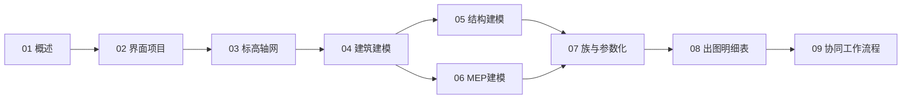

# Revit 知识地图

> Revit 的结构化导航 —— 基础 → 三专业建模 → 族 → 出图 → 协同。

## 分层总览

```
Revit
├── 基础
│   ├── 01 概述
│   ├── 02 界面与项目基础
│   └── 03 标高轴网与参照
├── 建模（三专业）
│   ├── 04 建筑建模
│   ├── 05 结构建模
│   └── 06 MEP 建模
├── 能力
│   ├── 07 族与参数化
│   └── 08 视图出图与明细表
└── 协同
    └── 09 协同与工作流程
```

## 学习路线



## 关联

[[62-Revit|主索引]] · [[62-工程学|62 工程学]] · [[62-004-BIM|62:004 BIM]]
