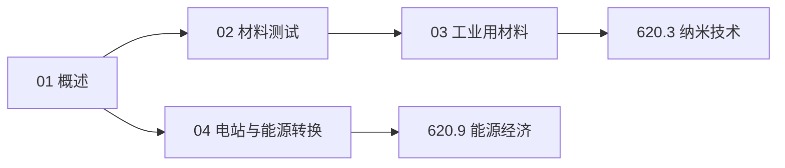

# 材料测试与能源知识地图

> UDC 620 的结构化导航 —— 材料侧（测试 · 选材）+ 能源侧（电站 · 经济）。

## 分层总览

```
620 材料测试与能源
├── 材料侧
│   ├── 02 材料测试（力学 · NDT · 标准）
│   └── 03 工业用材料（金属 / 无机 / 高分子 / 复合）
├── 能源侧
│   └── 04 电站与能源转换（电站 · 效率）
└── 下位子库
    ├── 620.3 纳米技术
    └── 620.9 能源经济
```

## 学习路线



## 关联

[[620-材料测试与能源|主索引]] · [[62-工程学|62 工程学]]
