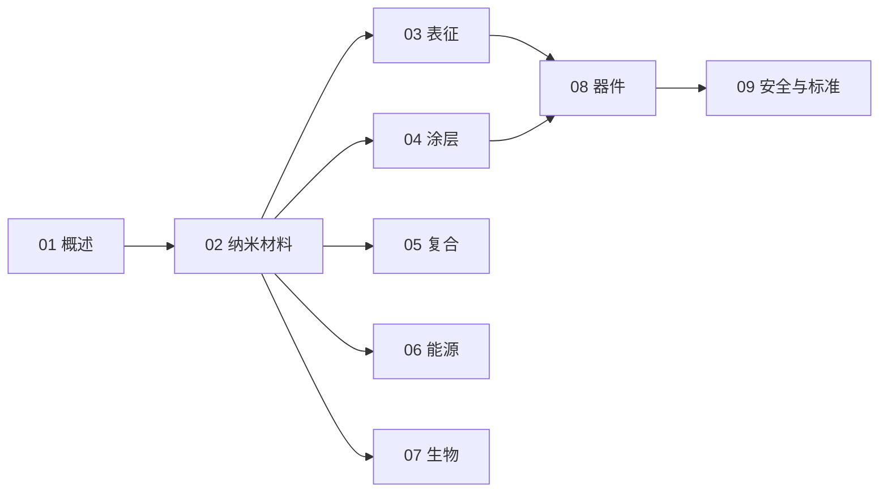

# 纳米技术知识地图

> 纳米技术（UDC 620.3）的结构化导航 —— 按「总论 → 材料 → 表征 → 涂层 / 复合 → 能源 / 生物 → 器件 → 安全标准」分层。

## 分层总览

```
纳米技术 620.3
├── 基础
│   ├── 01 概述（尺度 · 效应 · 路线）
│   └── 02 纳米材料（0D/1D/2D · 碳系 / 氧化物 / 二维）
├── 工具
│   └── 03 表征（SEM/TEM/STM/AFM · XRD · 拉曼）
├── 应用
│   ├── 04 涂层与表面（自清洁 · 超疏水 · 硬质）
│   ├── 05 复合材料（增强 · 界面 · 建材）
│   ├── 06 能源（电池 · 催化 · 光伏）
│   └── 07 生物医药（载体 · 诊断 · 抗菌）
└── 系统
    ├── 08 器件与制造（微纳加工 · 器件）
    └── 09 安全与标准
```

## 学习路线



## 关联

[[620.3-纳米技术|主索引]] · [[01-纳米技术概述|01 概述]] · [[62-工程学|62 工程学]]
