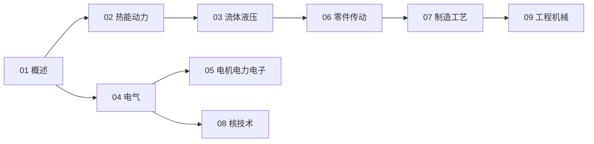

# 机械与电气工程知识地图

> UDC 621 的结构化导航 —— 动力 → 电气 → 机器（+ 核）。

## 分层总览

```
621 机械与电气工程
├── 动力
│   ├── 02 热能与动力机械
│   └── 03 流体机械与液压气动
├── 电气
│   ├── 04 电气工程
│   └── 05 电机与电力电子
├── 机器
│   ├── 06 机械零件与传动
│   ├── 07 机械制造工艺
│   └── 09 工程机械与自动化
└── 核
    └── 08 核技术
```

## 学习路线



## 关联

[[621-机械与电气工程|主索引]] · [[62-工程学|62 工程学]]
