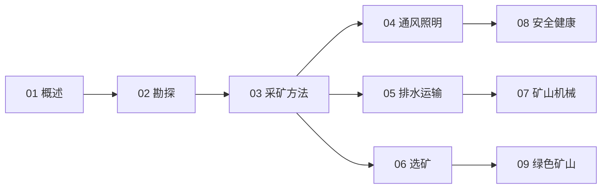

# 采矿工程知识地图

> 采矿工程（UDC 622）的结构化导航 —— 勘探 → 开采 → 保障 → 加工 → 安全 → 绿色。

## 分层总览

```
622 采矿工程
├── 前端
│   ├── 02 矿床勘探与地质
│   └── 03 采矿方法与开采工艺
├── 保障
│   ├── 04 矿井通风与照明
│   └── 05 矿井排水与运输提升
├── 后端
│   └── 06 选矿与矿物加工
├── 装备
│   └── 07 矿山机械与智能化
└── 约束
    ├── 08 矿山安全与职业健康
    └── 09 绿色矿山与环境修复
```

## 学习路线



## 关联

[[622-采矿工程|主索引]] · [[62-工程学|62 工程学]]
