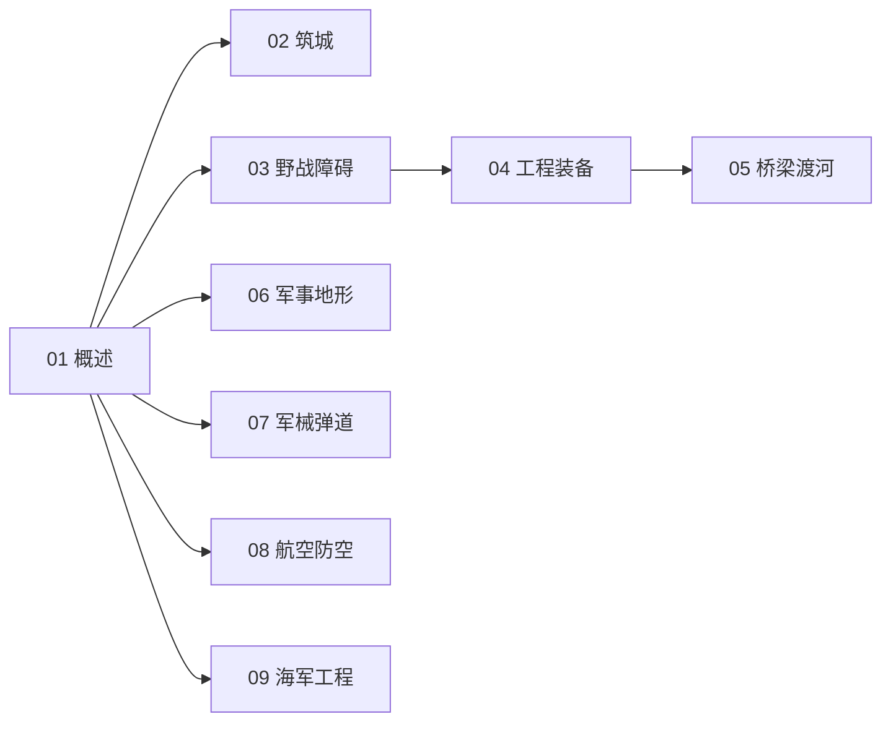

# 军事工程知识地图

> 军事工程（UDC 623）的结构化导航 —— 工程保障三分：机动 · 反机动 · 生存。

## 分层总览

```
623 军事工程
├── 生存（防护）
│   ├── 02 筑城与防御工事
│   └── 07 军械与弹道概述
├── 反机动（设障）
│   └── 03 野战工程与障碍物
├── 机动（保障通行）
│   ├── 04 工程装备与军用车辆
│   └── 05 军用桥梁与渡河
├── 信息 / 空间
│   └── 06 军事地形学与测绘
└── 军种工程
    ├── 08 军事航空与防空工程
    └── 09 海军工程与基地
```

## 学习路线



## 关联

[[623-军事工程|主索引]] · [[62-工程学|62 工程学]]
