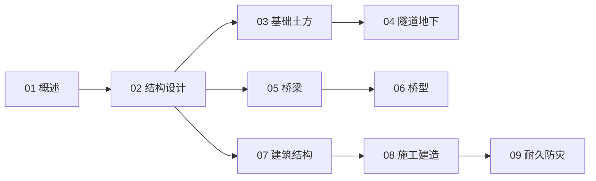

# 土木结构工程知识地图

> 土木结构工程（UDC 624）的结构化导航 —— 设计 → 地基 → 桥/隧道 → 房建 → 施工 → 防灾。

## 分层总览

```
624 土木结构工程
├── 设计
│   └── 02 结构设计与受力
├── 地基与地下
│   ├── 03 基础与土方工程
│   └── 04 隧道与地下工程
├── 桥与房
│   ├── 05 桥梁工程 → 06 桥型分类
│   └── 07 建筑结构
├── 建造
│   └── 08 施工组织与建造方法
└── 运维
    └── 09 结构耐久与防灾
```

## 学习路线



## 关联

[[624-土木结构工程|主索引]] · [[62-工程学|62 工程学]]
