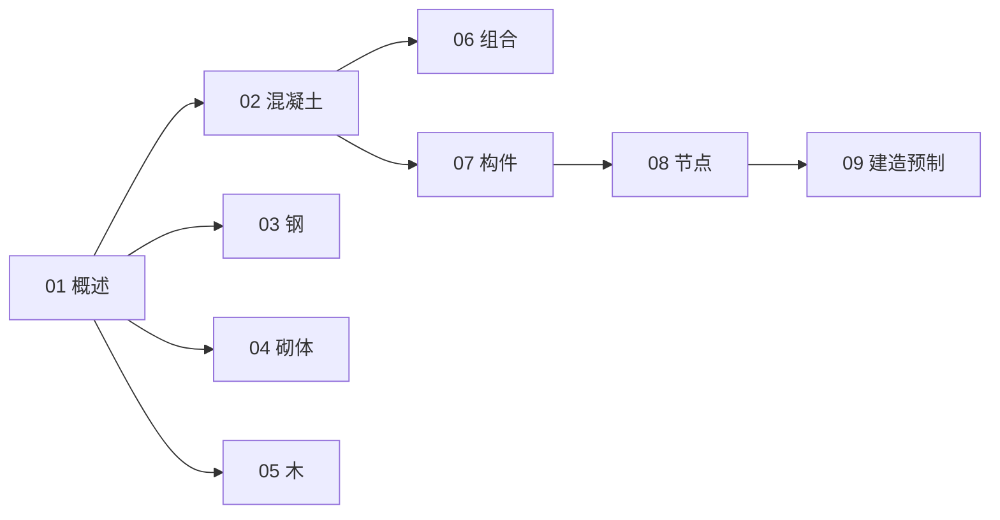

# 结构与结构件知识地图

> UDC 624.01 的结构化导航 —— 按**材料**与**构件 / 方法**两轴。

## 分层总览

```
624.01 结构与结构件
├── 按材料
│   ├── 02 混凝土结构
│   ├── 03 钢结构
│   ├── 04 砌体结构
│   ├── 05 木结构
│   └── 06 组合结构
└── 按构件 / 方法
    ├── 07 结构构件
    ├── 08 结构连接与节点
    └── 09 建造方法与预制
```

## 学习路线



## 关联

[[624.01-结构与结构件|主索引]] · [[624-土木结构工程|624 土木结构工程]]
