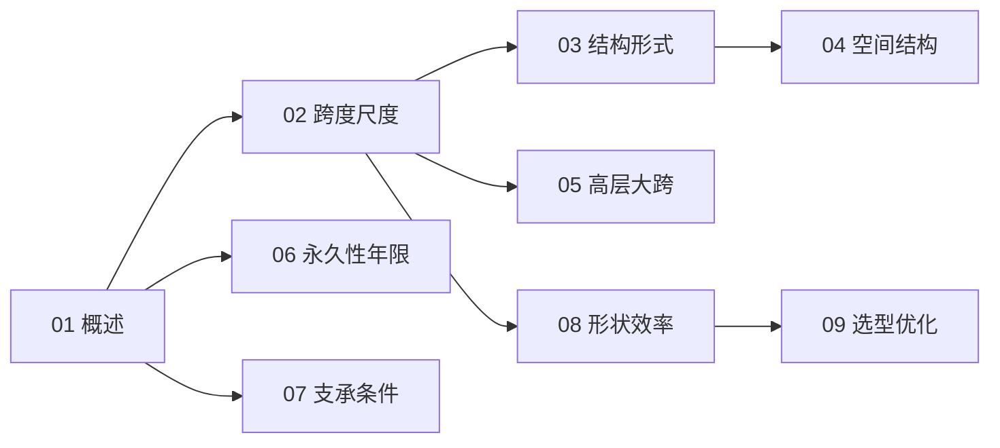

# 结构尺寸与形态知识地图

> UDC 624.03 的结构化导航 —— 尺度 → 形状 → 位置 → 永久性 → 选型。

## 分层总览

```
624.03 结构尺寸与形态
├── 尺度
│   ├── 02 跨度与尺度
│   └── 05 高层与大跨
├── 形状
│   ├── 03 结构形式与体型
│   ├── 04 空间结构
│   └── 08 形状与受力效率
├── 位置
│   └── 07 位置与支承条件
├── 永久性
│   └── 06 永久性与设计使用年限
└── 选型
    └── 09 结构选型与优化
```

## 学习路线



## 关联

[[624.03-结构尺寸与形态|主索引]] · [[624-土木结构工程|624 土木结构工程]]
