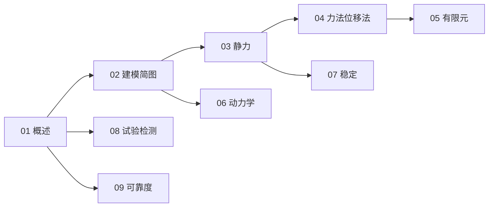

# 结构设计与分析知识地图

> UDC 624.04 的结构化导航 —— 建模 → 静力 → 方法 → 动力 / 稳定 → 试验 / 可靠度。

## 分层总览

```
624.04 结构设计与分析
├── 建模
│   └── 02 结构建模与计算简图
├── 静力
│   ├── 03 静力分析
│   ├── 04 力法与位移法
│   └── 05 矩阵位移法与有限元
├── 动力 / 稳定
│   ├── 06 结构动力学
│   └── 07 稳定性分析
└── 验证 / 概率
    ├── 08 结构试验与检测
    └── 09 可靠度与统计分析
```

## 学习路线



## 关联

[[624.04-结构设计与分析|主索引]] · [[624-土木结构工程|624 土木结构工程]]
