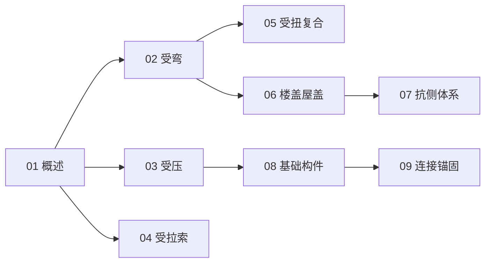

# 结构零件与承重部分知识地图

> UDC 624.07 的结构化导航 —— 按**受力**梳理构件 + 体系 + 连接。

## 分层总览

```
624.07 结构零件与承重部分
├── 按受力
│   ├── 02 受弯构件
│   ├── 03 受压构件
│   ├── 04 受拉构件与索
│   └── 05 受扭与复合受力
├── 体系
│   ├── 06 楼盖与屋盖
│   ├── 07 支撑与抗侧体系
│   └── 08 承重基础构件
└── 连接
    └── 09 连接件与锚固
```

## 学习路线



## 关联

[[624.07-结构零件与承重部分|主索引]] · [[624-土木结构工程|624 土木结构工程]]
