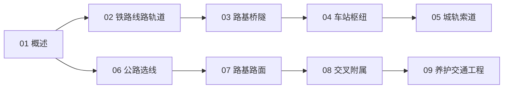

# 陆运工程知识地图

> 陆运工程（UDC 625）的结构化导航 —— 铁路（线路/轨道/站场）+ 公路（选线/路面/交叉）。

## 分层总览

```
625 陆运工程
├── 铁路
│   ├── 02 铁路线路与轨道
│   ├── 03 铁路路基与桥隧
│   └── 04 铁路车站与枢纽
├── 轨道城市
│   └── 05 城市轨道交通与索道
└── 公路
    ├── 06 公路勘测与选线
    ├── 07 路基与路面
    ├── 08 道路交叉与附属设施
    └── 09 道路养护与交通工程
```

## 学习路线



## 关联

[[625-陆运工程|主索引]] · [[62-工程学|62 工程学]]
