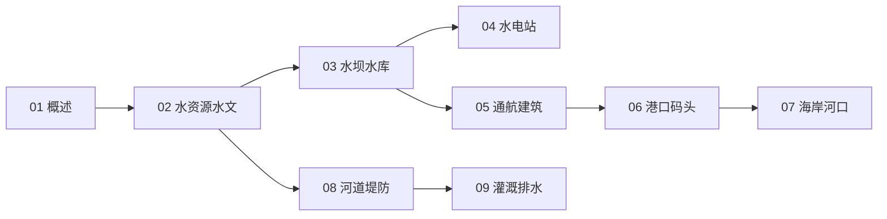

# 水力工程知识地图

> 水力工程（UDC 626/627）的结构化导航 —— 水文 → 蓄泄 → 发电 → 航运港工 → 防洪排水。

## 分层总览

```
626/627 水力工程
├── 基础
│   ├── 02 水资源与水文
│   └── 03 水坝与水库
├── 利用
│   ├── 04 水电站与水力机械
│   └── 05 通航建筑物
├── 水运 / 海岸
│   ├── 06 港口与码头工程
│   └── 07 海岸与河口工程
└── 防护 / 农业
    ├── 08 河道整治与堤防防洪
    └── 09 灌溉排水与围垦
```

## 学习路线



## 关联

[[626-627-水力工程|主索引]] · [[62-工程学|62 工程学]]
