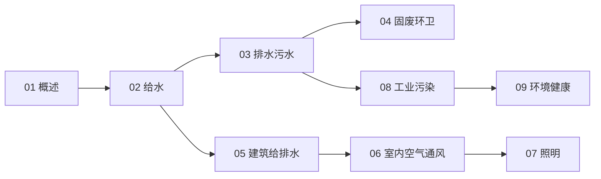

# 公共卫生工程知识地图

> 公共卫生工程（UDC 628）的结构化导航 —— 水循环（给水/排水/固废）+ 室内环境 + 污染治理。

## 分层总览

```
628 公共卫生工程
├── 水
│   ├── 02 给水与水质处理
│   ├── 03 排水与污水处理
│   └── 05 建筑给排水与卫生设施
├── 固废
│   └── 04 固废与环卫
├── 室内环境
│   ├── 06 室内空气与通风空调
│   └── 07 照明工程
├── 污染治理
│   └── 08 工业污染防治
└── 健康
    └── 09 环境健康与公共卫生
```

## 学习路线



## 关联

[[628-公共卫生工程|主索引]] · [[62-工程学|62 工程学]]
