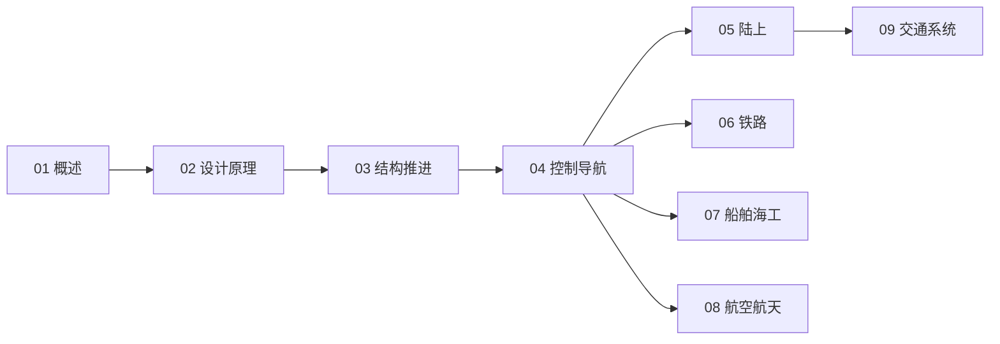

# 交通工程知识地图

> 交通工程（UDC 629）的结构化导航 —— 设计 → 结构推进 → 控制导航 → 各载具 → 系统。

## 分层总览

```
629 交通工程
├── 通用
│   ├── 02 交通工具设计原理
│   ├── 03 车辆结构与推进
│   └── 04 车辆控制与导航
├── 载具
│   ├── 05 陆上交通工具
│   ├── 06 铁路交通
│   ├── 07 船舶与海洋工程
│   └── 08 航空航天
└── 系统
    └── 09 交通系统与智能交通
子库：629.7 飞控
```

## 学习路线



## 关联

[[629-交通工程|主索引]] · [[62-工程学|62 工程学]]
