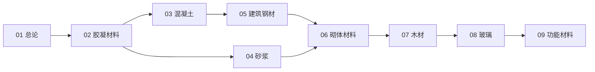

# 建筑材料知识地图

> 建筑材料（UDC 691）的结构化导航 —— 按「总论 → 胶结 → 结构主材 → 围护木作 → 功能材料」分层。

## 分层总览

```
建筑材料 691
├── 基础胶结（水硬 / 气硬）
│   ├── 胶凝材料（水泥 · 石灰 · 石膏 · 外加剂）
│   └── 混凝土 · 砂浆
├── 结构主材
│   ├── 建筑钢材（钢筋 · 型钢 · 钢丝）
│   └── 砌体材料（砖 · 砌块 · ALC · 石材）
├── 围护与木作
│   ├── 玻璃（安全 · 节能）
│   └── 木材（原木 → 人造板 → 工程木）
└── 功能材料
    └── 防水 · 保温 · 密封
```

## 学习路线



> 01–09 全部落笔（2026-10-08）。

## 关联

[[691-建筑材料|主索引]] · [[01-建筑材料总论|01 总论]] · [[69-城建与建筑|69 城建与建筑]]
