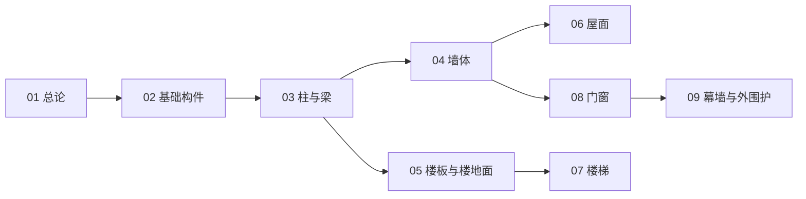

# 建筑构件知识地图

> 建筑构件（UDC 692）的结构化导航 —— 按「总论 → 结构构件 → 围护构件 → 竖向交通 → 外围护」分层。

## 分层总览

```
建筑构件 692
├── 结构构件（承载 / 传力）
│   ├── 基础构件
│   ├── 柱与梁
│   └── 楼板
├── 围护构件（防水 / 保温 / 采光）
│   ├── 墙体
│   ├── 屋面
│   └── 门窗
├── 分隔与竖向交通
│   ├── 楼地面（分隔 / 隔声）
│   └── 楼梯
└── 外围护（非承重外挂）
    └── 幕墙与外围护
```

## 学习路线



> 01–09 全部落笔（2026-10-09）。

## 关联

[[692-建筑构件|主索引]] · [[01-建筑构件总论|01 总论]] · [[69-城建与建筑|69 城建与建筑]]
