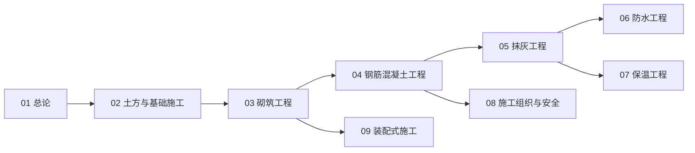

# 砌筑工艺知识地图

> 砌筑与建筑工艺（UDC 693）的结构化导航 —— 按「总论 → 地下 → 主体 → 装饰基层 → 防护 → 组织 → 工业化」分层。

## 分层总览

```
砌筑与建筑工艺 693
├── 地下
│   └── 土方与基础施工
├── 主体工艺
│   ├── 砌筑工程（砖 · 砌块 · 石）
│   └── 钢筋混凝土工程（模板 · 钢筋 · 浇筑）
├── 装饰基层
│   └── 抹灰工程
├── 防护
│   ├── 防水工程
│   └── 保温工程
├── 组织
│   └── 施工组织与安全
└── 工业化
    └── 装配式施工
```

## 学习路线



> 01–09 全部落笔（2026-10-09）。

## 关联

[[693-砌筑与建筑工艺|主索引]] · [[01-砌筑与建筑工艺总论|01 总论]] · [[69-城建与建筑|69 城建与建筑]]
