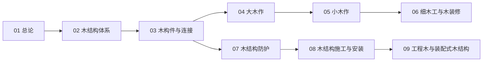

# 木作知识地图

> 木结构与木作（UDC 694）的结构化导航 —— 按「总论 → 结构 → 木作 → 装修 → 防护 → 工业化」分层。

## 分层总览

```
木结构与木作 694
├── 结构
│   ├── 木结构体系（抬梁 / 穿斗 · 轻型 · 胶合木）
│   └── 木构件与连接（榫卯 · 齿连接 · 金属件）
├── 传统木作
│   ├── 大木作（柱梁枋檩椽 · 斗拱）
│   └── 小木作（门窗 · 隔断 · 天花）
├── 装修
│   └── 细木工与木装修（橱柜 · 木饰面 · 地板）
├── 防护
│   └── 木结构防护（防腐 · 防虫 · 防火）
└── 工业化
    ├── 木结构施工与安装
    └── 工程木与装配式木结构（CLT · GLM · Timber-MiC）
```

## 学习路线



> 01–09 全部落笔（2026-10-09）。

## 关联

[[694-木结构与木作|主索引]] · [[01-木结构与木作总论|01 总论]] · [[69-城建与建筑|69 城建与建筑]]
