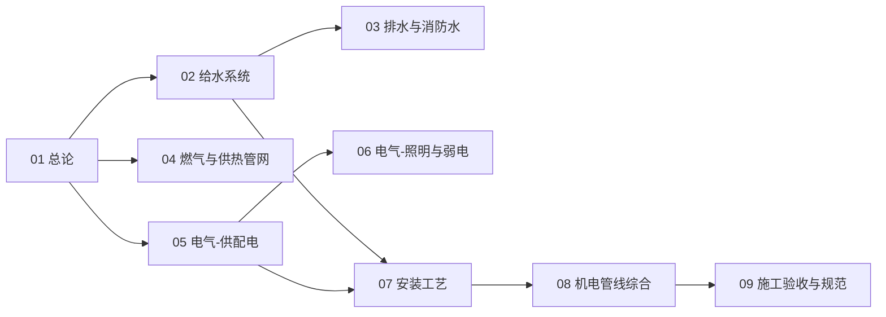

# 建筑设备知识地图

> 建筑设备与安装（UDC 696）的结构化导航 —— 按「总论 → 水 → 气 / 热 → 电 → 安装 → 综合 → 验收」分层。

## 分层总览

```
建筑设备与安装 696
├── 水
│   ├── 建筑给水系统
│   └── 建筑排水与消防水
├── 气 / 热
│   └── 燃气与供热管网
├── 电
│   ├── 建筑电气-供配电
│   └── 建筑电气-照明与弱电
├── 落地
│   └── 安装工艺（连接 · 支撑 · 试验）
├── 综合
│   └── 机电管线综合（BIM · 支吊架）
└── 收口
    └── 施工验收与规范
```

## 学习路线



> 01–09 全部落笔（2026-10-09）。

## 关联

[[696-建筑设备与安装|主索引]] · [[01-建筑设备与安装总论|01 总论]] · [[69-城建与建筑|69 城建与建筑]]
