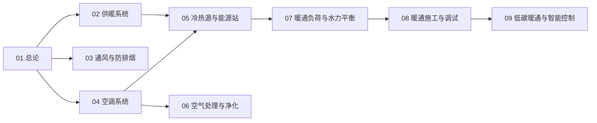

# 暖通空调知识地图

> 暖通空调（UDC 697）的结构化导航 —— 按「总论 → 三大功能 → 源与输配 → 空气 → 设计 → 施工 → 低碳」分层。

## 分层总览

```
暖通空调 697
├── 三大功能
│   ├── 供暖系统（散热器 · 地暖）
│   ├── 通风与防排烟
│   └── 空调系统（中央 · 多联机）
├── 源与输配
│   ├── 冷热源与能源站（锅炉 · 热泵 · 冷水机组）
│   └── 暖通负荷与水力平衡
├── 空气
│   └── 空气处理与净化（新风 · 过滤 · 洁净）
├── 落地
│   └── 暖通施工与调试
└── 低碳
    └── 低碳暖通与智能控制
```

## 学习路线



> 01–09 全部落笔（2026-10-09）。

## 关联

[[697-暖通空调|主索引]] · [[01-暖通空调总论|01 总论]] · [[69-城建与建筑|69 城建与建筑]]
