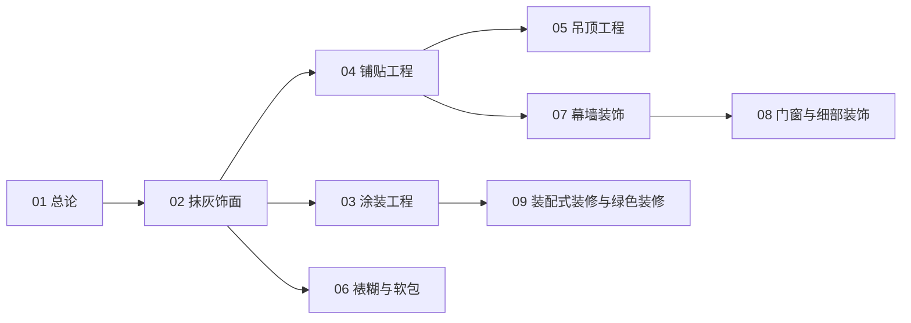

# 装饰装修知识地图

> 装饰装修（UDC 698）的结构化导航 —— 按「总论 → 造基面 → 造面层 → 悬挂 → 覆面 → 外围护 → 洞口 → 工业化」分层。

## 分层总览

```
装饰装修 698
├── 造基面
│   └── 抹灰饰面（找平 · 粘结 · 吸水均一）
├── 造面层
│   ├── 涂装工程
│   └── 铺贴工程
├── 悬挂
│   └── 吊顶工程
├── 覆面
│   └── 裱糊与软包
├── 外围护
│   └── 幕墙装饰
├── 洞口
│   └── 门窗与细部装饰
└── 工业化
    └── 装配式装修与绿色装修
```

## 学习路线



> 01–09 全部落笔（2026-10-09）。

## 关联

[[698-装饰装修|主索引]] · [[01-装饰装修总论|01 总论]] · [[69-城建与建筑|69 城建与建筑]]
