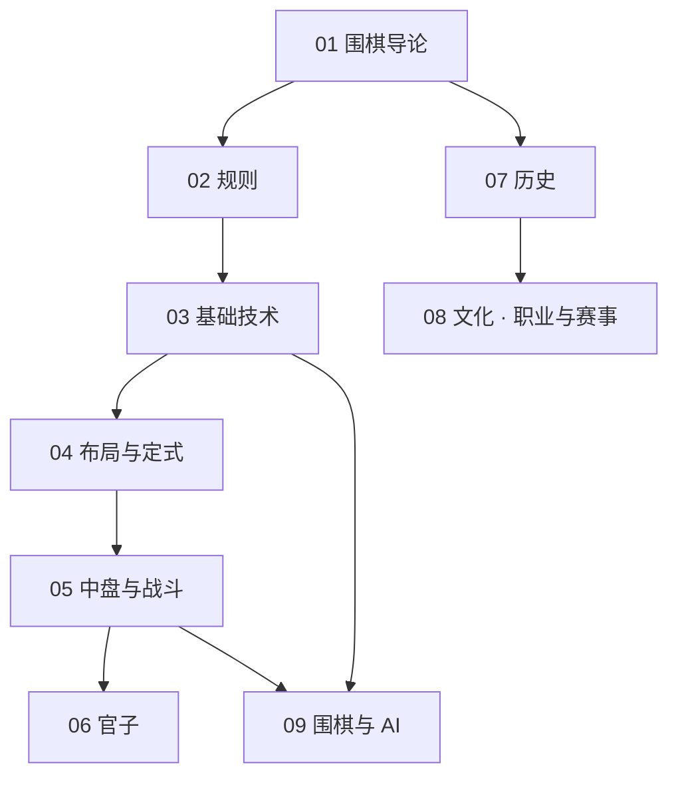

# 围棋知识地图

## 分层学习路线

| 层级 | 能力 | 对应章节 |
|:--:|------|:--:|
| L1 | 理解围棋本质与规则 | 01–02 |
| L2 | 掌握基础技术（气 / 眼 / 死活 / 手筋） | 03 |
| L3 | 布局与定式 | 04 |
| L4 | 中盘战斗与官子 | 05–06 |
| L5 | 历史 · 文化 · 职业 · AI | 07–09 |

## 三条主线

| 主线 | 内容 |
|------|------|
| **技术线** | 规则 → 基础技术 → 布局定式 → 中盘 → 官子 |
| **文化线** | 导论 → 历史 → 文化 · 职业与赛事 |
| **AI 线** | 基础技术 / 中盘 → 围棋与 AI（AlphaGo 等） |

## 关联

[[794-围棋|794 围棋]] · [[794-围棋/wiki/index|Wiki 索引]] · [[794-围棋/99-资源收集/资源总览|资源总览]]
