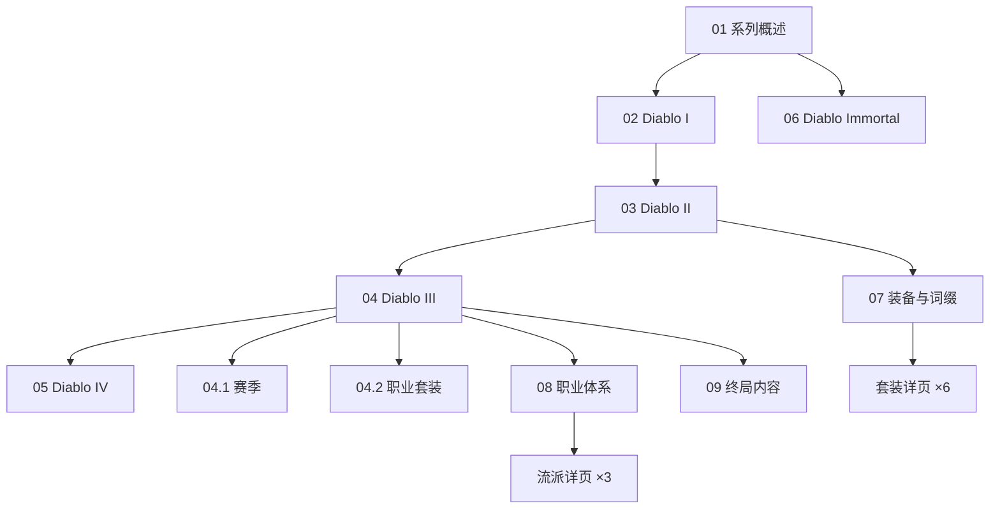

# 暗黑破坏神知识地图

## 分层学习路线

| 层级 | 能力 | 对应章节 |
|:--:|------|:--:|
| L1 | 系列与 ARPG 类型 | 01 |
| L2 | 早期三部曲（I / II） | 02–03 |
| L3 | Diablo III（含赛季 / 套装） | 04（04.1 · 04.2） |
| L4 | IV / Immortal | 05–06 |
| L5 | 装备词缀 · 职业流派 · 终局 | 07–09 |

## 三条主线

| 主线 | 内容 |
|------|------|
| **系列线** | 系列概述 → I → II → III → IV / Immortal（01–06） |
| **养成线** | 装备与词缀（07）→ 职业体系与流派（08） |
| **终局线** | 赛季（04.1）· 套装（04.2）→ 终局内容（09） |

## 关联

[[794-暗黑破坏神|794 暗黑破坏神]] · [[794-暗黑破坏神/wiki/index|Wiki 索引]] · [[794-暗黑破坏神/99-资源收集/资源总览|资源总览]]
