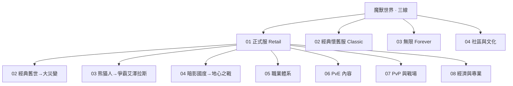

# 魔兽世界知识地图

## 分层学习路线

| 层级 | 能力 | 对应 |
|:--:|------|:--:|
| L1 | 三条产品线全景（正式服 / 经典怀旧服 / 无限） | 01–03 |
| L2 | 正式服：资料片史 | 01（子页 02–04） |
| L3 | 正式服：职业 · PvE · PvP · 经济 | 01（子页 05–08） |
| L4 | 经典怀旧服（复刻 · SoD · 永久 60） | 02 |
| L5 | 无限 (Forever) | 03 |
| ∞ | 社区与文化（跨三线） | 04 |

## 三条主线

| 主线 | 内容 |
|------|------|
| **产品线** | 正式服（01）· 经典怀旧服（02）· 无限（03） |
| **玩法线（正式服）** | 资料片史（子页 02–04）→ 职业 / PvE / PvP / 经济（子页 05–08） |
| **文化线（跨线）** | 社区与文化（04） |

## 关联

[[794-魔兽世界|794 魔兽世界]] · [[794-魔兽世界/wiki/index|Wiki 索引]] · [[794-魔兽世界/99-资源收集/资源总览|资源总览]]
