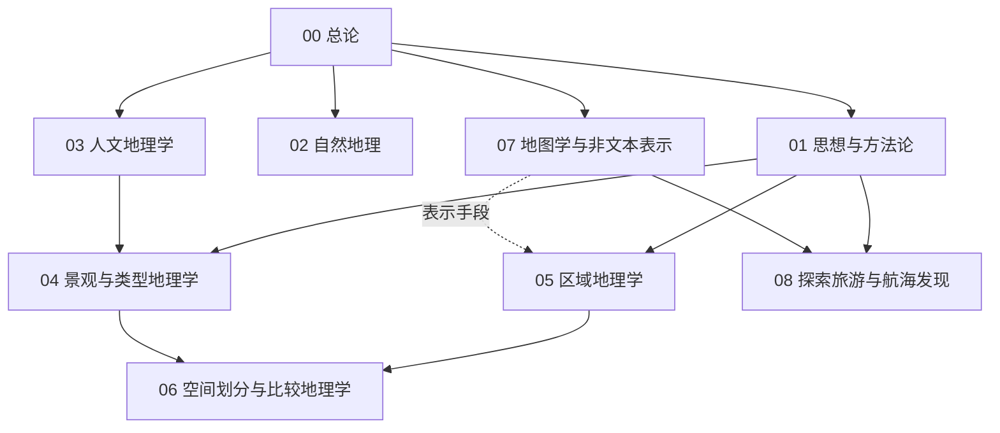

# 地理学知识地图

## 分层学习路线

| 层级 | 能力 | 对应章节 |
|:--:|------|:--:|
| L1 | 掌握地理学的定义、分支与方法 | 00–01 |
| L2 | 理解自然与人文两大地理面 | 02–03 |
| L3 | 理解景观、区域与空间理论 | 04–06 |
| L4 | 掌握地图表示与探索传统 | 07–08 |

## 三条主线

| 主线 | 内容 |
|------|------|
| **理论线** | 方法论 → 类型地理 → 空间划分 → 比较地理 |
| **两面线** | 自然地理 ↔ 人文地理（人地关系两翼） |
| **表示线** | 地图 → 区域地理 → 探索与航海发现 |

## 三条线的交汇点

| 交汇 | 说明 |
|------|------|
| 人地关系 | [[02-自然地理\|自然]] 与 [[03-人文地理学\|人文]] 两面共同构成地理学核心命题 |
| 景观综合 | [[04-景观与类型地理学\|景观]] 是自然与人文的**交汇地带** |
| 地图 | [[07-地图学与非文本表示\|地图]] 既是理论产物，又是探索工具 |

## 关联

[[91-地理学]] · [[91-地理学/wiki/index|Wiki 索引]] · [[91-地理学/99-资源收集/资源总览|资源总览]]
