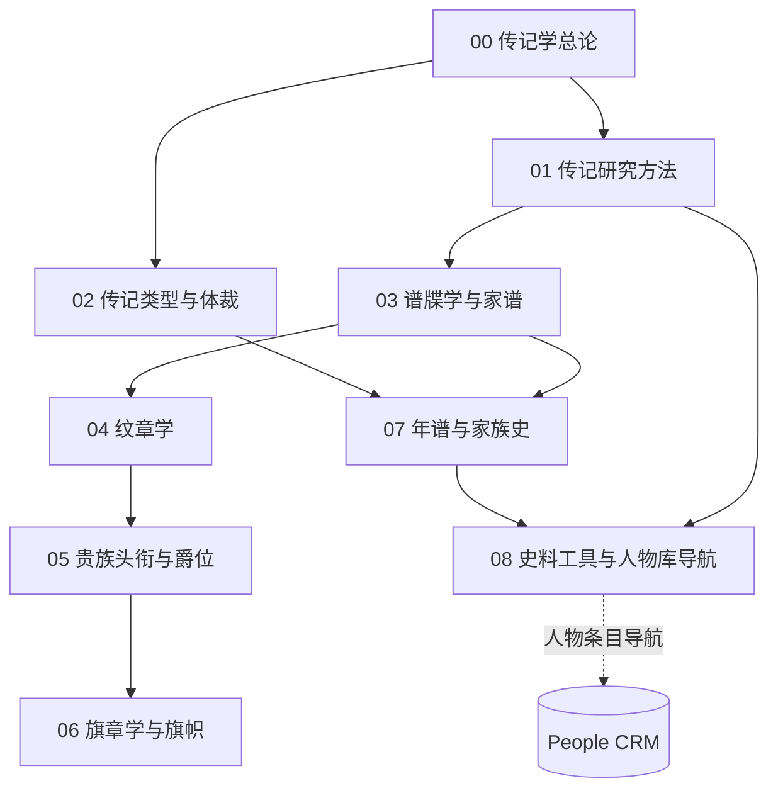

# 传记学知识地图

> ⚠️ **人物条目一律落 [[3 Resources/People/People|People CRM]]**，本库为**类目 + 导航**库（R2 裁定 = A）。

## 分层学习路线

| 层级 | 能力 | 对应章节 |
|:--:|------|:--:|
| L1 | 掌握传记学的定义、方法与体裁 | 00–02 |
| L2 | 理解谱系与身份制度（谱牒 · 纹章 · 贵族）| 03–05 |
| L3 | 理解旗帜与编年家史 | 06–07 |
| L4 | 掌握史料、工具与人物库导航 | 08 |

## 三条主线

| 主线 | 内容 |
|------|------|
| **方法线** | 总论 → 研究方法 → 体裁 → 年谱 |
| **身份线** | 谱牒 → 纹章 → 贵族爵位 → 旗帜 |
| **工具线** | 年谱 → 史料工具 → 人物库导航 |

## 三条线的交汇点

| 交汇 | 说明 |
|------|------|
| 身份标识 | [[04-纹章学\|纹章]] 与 [[06-旗章学与旗帜\|旗帜]] 同为**非文本表示**的身份符号 |
| 世系骨架 | [[03-谱牒学与家谱\|谱牒]] 与 [[07-年谱与家族史\|年谱]] 共同构成生平考订的骨架 |
| 导航 | [[08-史料工具与人物库导航\|第 08 章]] 汇辑史料并**导航至 People CRM** |

## 关联

[[92-传记]] · [[92-传记/wiki/index|Wiki 索引]] · [[92-传记/99-资源收集/资源总览|资源总览]]
