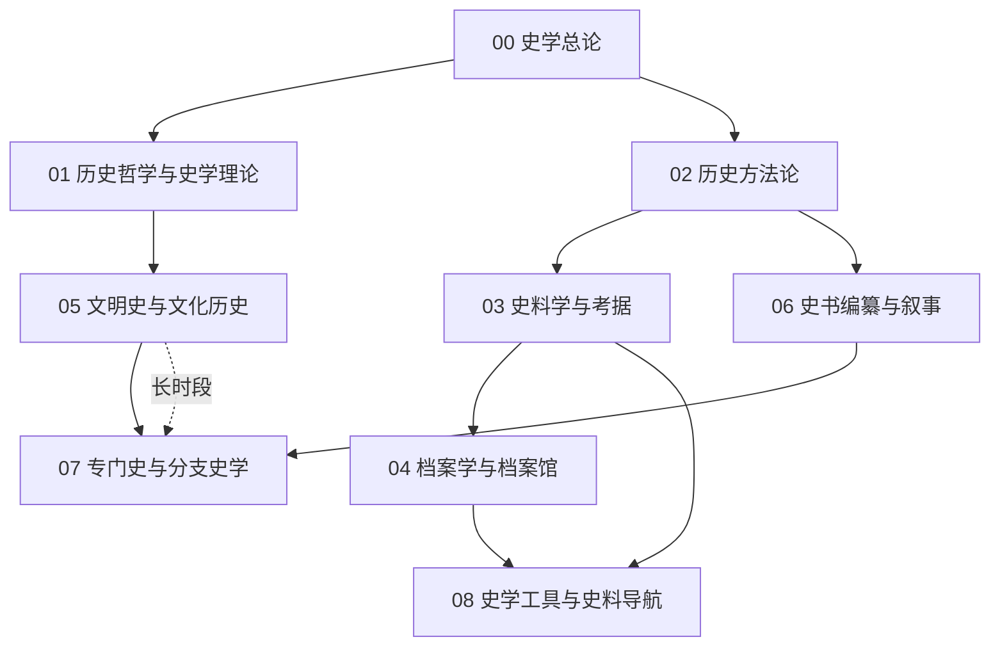

# 史学知识地图

> **分界**：本库收「怎么写 / 怎么研究」（`93/930`）；「历史本身」→ [[94-历史|94 历史]]。

## 分层学习路线

| 层级 | 能力 | 对应章节 |
|:--:|------|:--:|
| L1 | 掌握史学的定义、理论与方法 | 00–02 |
| L2 | 掌握史料批判与档案利用 | 03–04 |
| L3 | 理解文明史与编纂传统 | 05–06 |
| L4 | 掌握分支史学与工具导航 | 07–08 |

## 三条主线

| 主线 | 内容 |
|------|------|
| **理论线** | 总论 → 历史哲学 → 方法论 → 史料学 |
| **存藏线** | 史料 → 档案 → 工具导航 |
| **编纂线** | 文明史 → 史书编纂 → 分支史学 |

## 三条线的交汇点

| 交汇 | 说明 |
|------|------|
| 史料批判 | [[02-历史方法论\|方法]] · [[03-史料学与考据\|史料]] · [[04-档案学与档案馆\|档案]] 三章共构**证据链** |
| 长时段 | [[05-文明史与文化历史\|文明史]] 与 [[07-专门史与分支史学\|专门史]] 共享**结构视角** |
| 导航 | [[08-史学工具与史料导航\|第 08 章]] 汇辑工具并**导航跨库** |

## 关联

[[93-史学]] · [[93-史学/wiki/index|Wiki 索引]] · [[93-史学/99-资源收集/资源总览|资源总览]]
