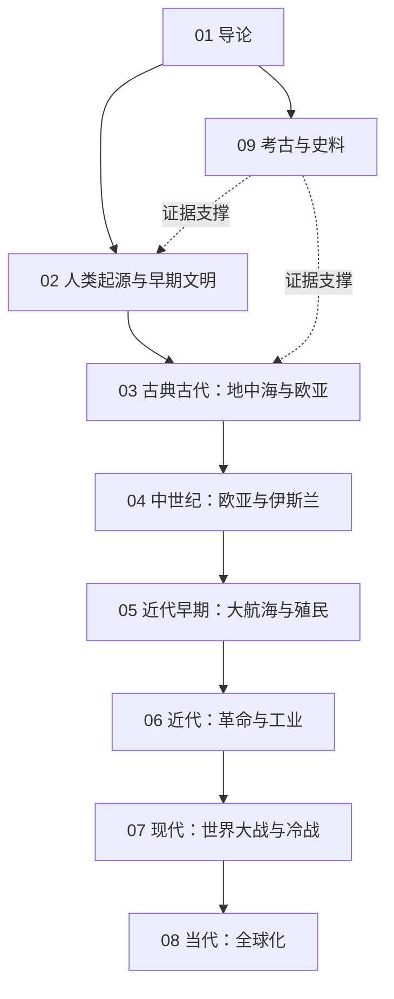

# 世界史知识地图

## 分层学习路线

| 层级 | 能力 | 对应章节 |
|:--:|------|:--:|
| L1 | 掌握全球史分期与史料分布 | 01 |
| L2 | 理解文明起源与古典帝国 | 02–03 |
| L3 | 理解中世纪整合与近代转型 | 04–05 |
| L4 | 理解现代全球一体与当代 | 06–08 |

## 三条主线

| 主线 | 内容 |
|------|------|
| **文明线** | 农业革命 → 首批文明 → 轴心时代 → 帝国与宗教 |
| **交流线** | 丝绸之路 → 蒙古欧亚 → 大航海 → 殖民与全球贸易 |
| **变革线** | 文艺复兴 → 革命 → 工业革命 → 民族国家 → 全球化 |

## 三条线的交汇点

| 交汇 | 说明 |
|------|------|
| 轴心时代 | [[03-古典古代：地中海与欧亚\|古典古代]] 中诸文明几乎同时涌现思想突破 |
| 蒙古欧亚 | [[04-中世纪：欧亚与伊斯兰\|中世纪]] 的欧亚整合首次打通东西交流 |
| 大航海 | [[05-近代早期：大航海与殖民\|大航海]] 使世界由分散走向一体 |
| 工业革命 | [[06-近代：革命与工业\|工业革命]] 造成东西方力量对比的根本翻转 |

## 关联

[[94(100)-世界史]] · [[94-历史/94(100)-世界史/wiki/index|Wiki 索引]] · [[94-历史/94(100)-世界史/99-资源收集/资源总览|资源总览]]
