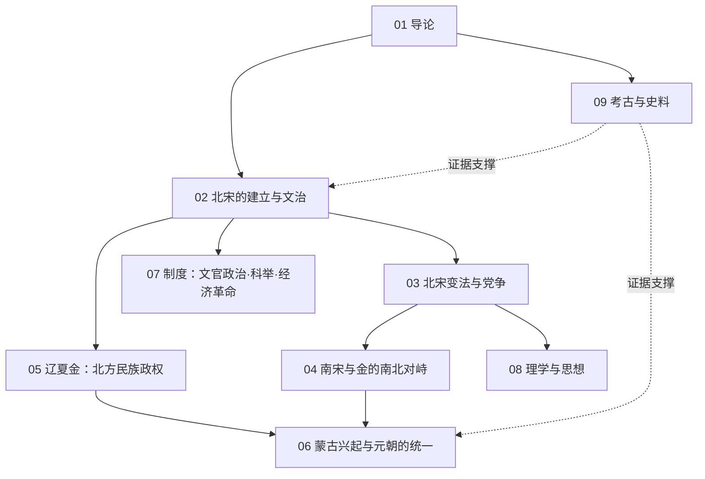

# 宋元知识地图

## 分层学习路线

| 层级 | 能力 | 对应章节 |
|:--:|------|:--:|
| L1 | 掌握时段、分期与史料分布 | 01 |
| L2 | 理解文官政治与近世繁荣 | 02–03、07 |
| L3 | 理解民族政权并立与南北对峙 | 04–05 |
| L4 | 理解蒙古统一与理学主导的思想格局 | 06–08 |

## 三条主线

| 主线 | 内容 |
|------|------|
| **政治线** | 北宋建立 → 变法党争 → 靖康之变 → 南宋金对峙 → 蒙古统一 |
| **民族线** | 辽 → 西夏 → 金 → 元，多民族并立与整合 |
| **文化线** | 文治 → 理学兴起 → 市民文化 → 科技繁荣 |

## 三条线的交汇点

| 交汇 | 说明 |
|------|------|
| 经济革命 | [[07-制度：文官政治·科举·经济革命\|经济与城市]]的繁荣是近世论的核心证据 |
| 理学 | [[08-理学与思想\|程朱理学]]在宋代兴起，主导此后数百年 |
| 元的大一统 | [[06-蒙古兴起与元朝的统一\|元]]以行省制整合多民族，奠定后世疆域框架 |

## 关联

[[94(510)-宋元]] · [[94-历史/94(510)-宋元/wiki/index|Wiki 索引]] · [[94-历史/94(510)-宋元/99-资源收集/资源总览|资源总览]]
