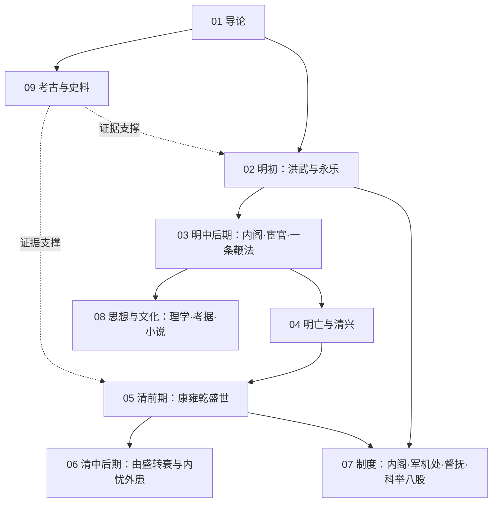

# 明清知识地图

## 分层学习路线

| 层级 | 能力 | 对应章节 |
|:--:|------|:--:|
| L1 | 掌握时段、分期与史料分布 | 01 |
| L2 | 理解明代集权建制与改革 | 02–04、09 |
| L3 | 理解清代盛世的成就与制度 | 05、07 |
| L4 | 理解帝制晚期向近代的转折 | 06、08 |

## 三条主线

| 主线 | 内容 |
|------|------|
| **政治线** | 洪武建制 → 内阁宦官 → 张居正改革 → 明清易代 → 康雍乾 → 衰亡 |
| **制度线** | 废丞相 → 内阁 → 军机处 · 督抚 · 八股科举 |
| **文化线** | 心学 → 考据学 → 小说戏曲 → 西学东渐 |

## 三条线的交汇点

| 交汇 | 说明 |
|------|------|
| 高度集权 | [[07-制度：内阁·军机处·督抚·科举八股\|制度]]由内阁至军机处，皇权空前集中 |
| 盛世与隐患 | [[05-清前期：康雍乾盛世\|康乾盛世]]的顶点同时孕育闭关与衰象 |
| 近代转型 | [[06-清中后期：由盛转衰与内忧外患\|鸦片战争]]迫使中国步入近代 |

## 关联

[[94(510)-明清]] · [[94-历史/94(510)-明清/wiki/index|Wiki 索引]] · [[94-历史/94(510)-明清/99-资源收集/资源总览|资源总览]]
