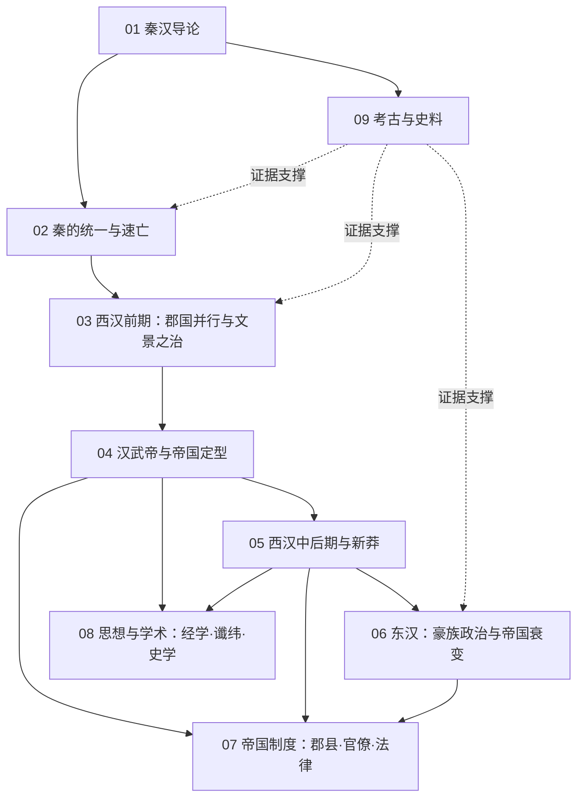

# 秦汉知识地图

## 分层学习路线

| 层级 | 能力 | 对应章节 |
|:--:|------|:--:|
| L1 | 掌握时段、分期与史料分布 | 01 |
| L2 | 理解秦制的创制与其速亡的结构性原因 | 02、09 |
| L3 | 理解汉承秦制、郡国博弈与武帝定型的制度逻辑 | 03–05、07 |
| L4 | 理解儒学独尊、豪族政治与帝国衰变的因果链 | 05–06、08 |

## 三条主线

| 主线 | 内容 |
|------|------|
| **制度线** | 郡县创制 → 郡国并行 → 推恩削藩 → 中央集权定型 → 豪族坐大 |
| **思想线** | 法家治术 → 黄老无为 → 独尊儒术 → 今古文之争 → 谶纬兴起 |
| **证据线** | 传世史书 → 简牍律令 → 印章封泥 → 画像石 → 二重证据法 |

## 三条线的交汇点

| 交汇 | 说明 |
|------|------|
| 汉承秦制 | [[02-秦的统一与速亡\|秦]]所创之制被 [[03-西汉前期：郡国并行与文景之治\|汉]] 承袭损益，奠定此后帝制框架（见 [[汉承秦制-Han-Inherits-Qin\|汉承秦制]]） |
| 儒表法里 | [[独尊儒术-Confucian-Orthodoxy\|独尊儒术]]并未废弃秦法，而是「儒」为表、「法」为里，构成帝制的意识形态双轨 |
| 简牍证史 | [[09-考古与史料：简牍·画像石·封泥\|09 章]]的出土律令（睡虎地 · 张家山 · 居延）修正了传世文献对秦政的单一苛暴叙述 |

## 关联

[[94(510)-秦汉]] · [[94-历史/94(510)-秦汉/wiki/index|Wiki 索引]] · [[94-历史/94(510)-秦汉/99-资源收集/资源总览|资源总览]]
