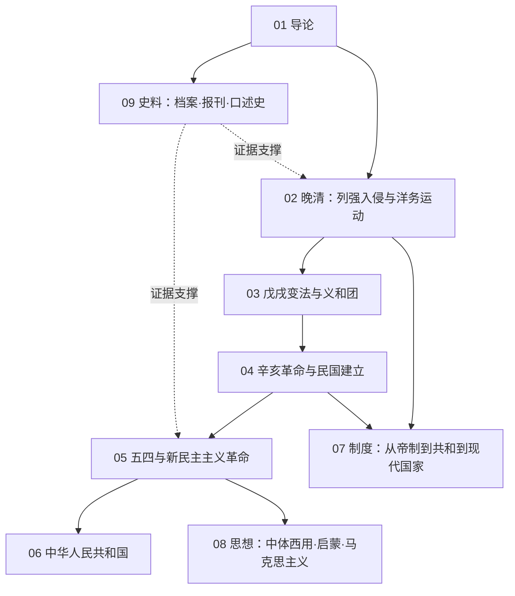

# 近现代知识地图

## 分层学习路线

| 层级 | 能力 | 对应章节 |
|:--:|------|:--:|
| L1 | 掌握时段、分期与史料分布 | 01 |
| L2 | 理解列强冲击与自强运动 | 02–03、09 |
| L3 | 理解革命、建国与制度转型 | 04–05、07 |
| L4 | 理解思想潮流与现代化路径 | 06、08 |

## 三条主线

| 主线 | 内容 |
|------|------|
| **政治线** | 鸦片战争 → 自强 → 维新 → 革命 → 民国 → 抗战 → 建国 → 改革 |
| **制度线** | 帝制 → 共和 → 党治 → 现代国家建设 |
| **思想线** | 中体西用 → 启蒙 → 三民主义 → 马克思主义 → 现代化 |

## 三条线的交汇点

| 交汇 | 说明 |
|------|------|
| 救亡与启蒙 | [[08-思想：中体西用·启蒙·马克思主义\|思想潮流]]始终交织「救亡」与「启蒙」双重主题 |
| 辛亥革命 | [[04-辛亥革命与民国建立\|辛亥革命]]终结帝制，是制度转型的枢纽 |
| 改革开放 | [[06-中华人民共和国\|改革开放]]使中国重返世界体系，是现代化的关键一步 |

## 关联

[[94(510)-近现代]] · [[94-历史/94(510)-近现代/wiki/index|Wiki 索引]] · [[94-历史/94(510)-近现代/99-资源收集/资源总览|资源总览]]
