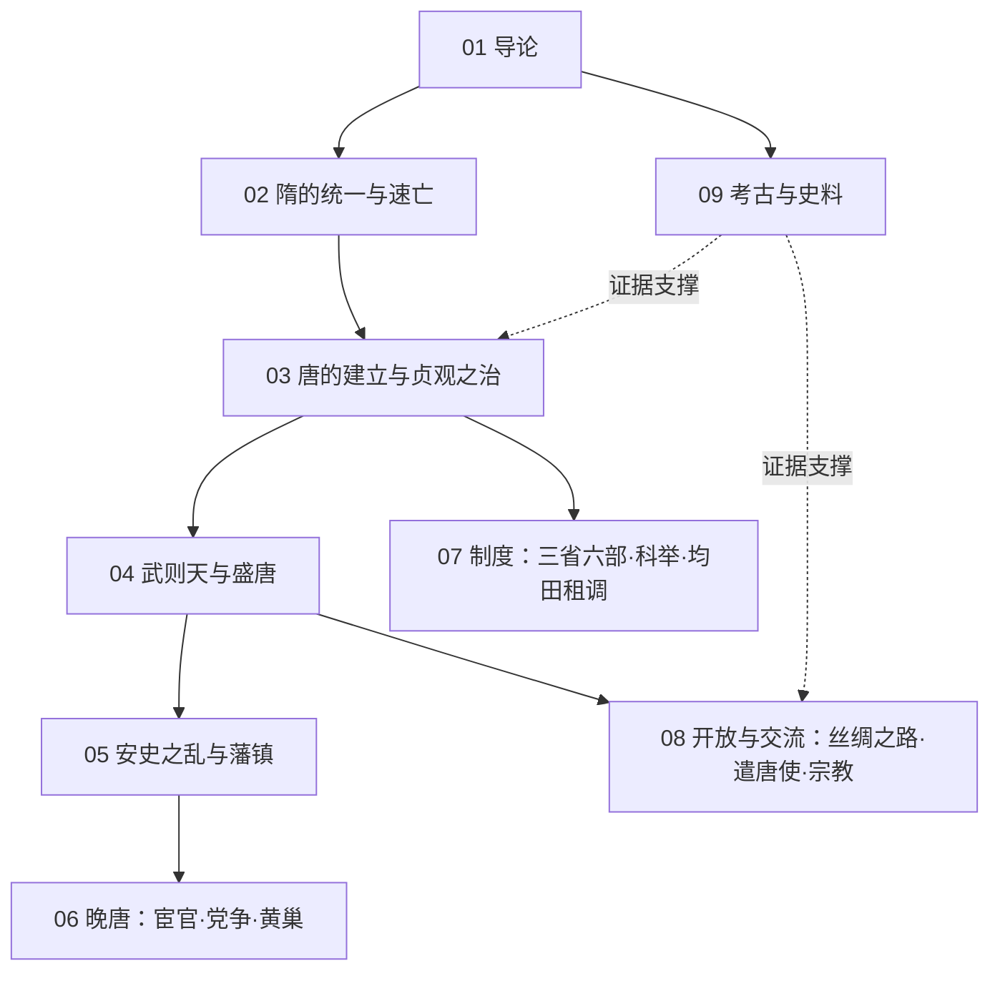

# 隋唐知识地图

## 分层学习路线

| 层级 | 能力 | 对应章节 |
|:--:|------|:--:|
| L1 | 掌握时段、分期与史料分布 | 01 |
| L2 | 理解再统一与制度创制 | 02–03、09 |
| L3 | 理解鼎盛期的政治与文化 | 04–05、08 |
| L4 | 理解由盛转衰的内在机制 | 06–07 |

## 三条主线

| 主线 | 内容 |
|------|------|
| **政治线** | 隋统一 → 贞观 → 武周 → 开元 → 安史之乱 → 藩镇 → 黄巢 → 亡国 |
| **制度线** | 三省六部 → 科举 → 均田租庸调 → 两税法 |
| **交流线** | 丝路 → 遣唐使 → 三教并立 → 汉文化圈 |

## 三条线的交汇点

| 交汇 | 说明 |
|------|------|
| 科举制 | [[07-制度：三省六部·科举·均田租调\|科举]]既是制度史中枢，也是社会流动的引擎 |
| 安史之乱 | [[05-安史之乱与藩镇\|安史之乱]]是制度由均田府兵转向两税募兵的转折 |
| 长安 | [[08-开放与交流：丝绸之路·遣唐使·宗教\|丝路与遣唐使]]的枢纽，体现开放格局 |

## 关联

[[94(510)-隋唐]] · [[94-历史/94(510)-隋唐/wiki/index|Wiki 索引]] · [[94-历史/94(510)-隋唐/99-资源收集/资源总览|资源总览]]
