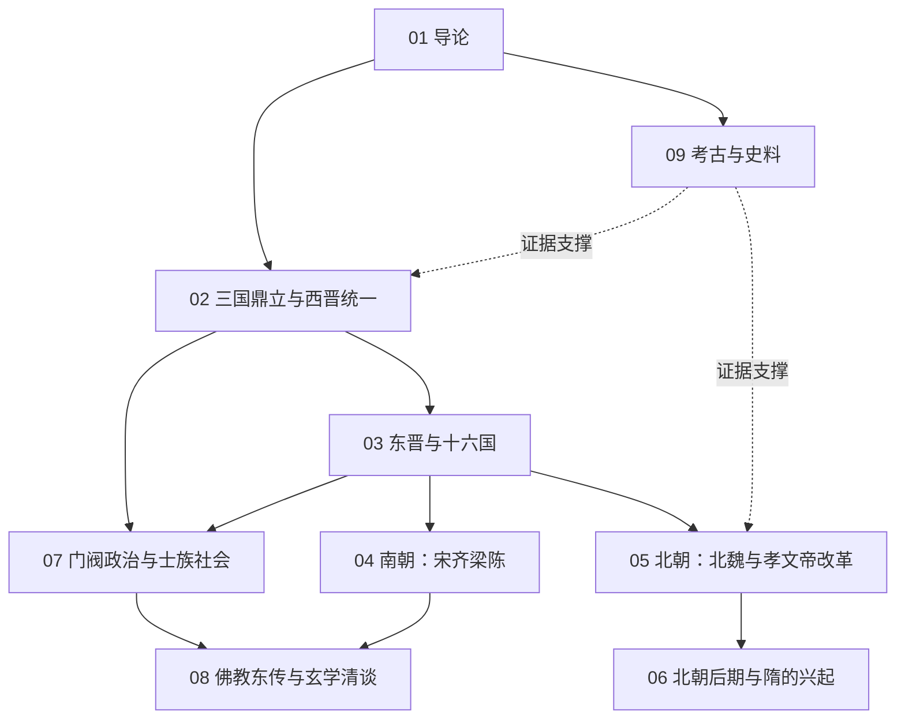

# 魏晋南北朝知识地图

## 分层学习路线

| 层级 | 能力 | 对应章节 |
|:--:|------|:--:|
| L1 | 掌握时段、分期与史料分布 | 01 |
| L2 | 理解大一统瓦解与南北对峙的格局 | 02–03、09 |
| L3 | 理解门阀政治与士族社会的结构逻辑 | 04–05、07 |
| L4 | 理解佛教东传、玄学与民族融合的文化后果 | 06–08 |

## 三条主线

| 主线 | 内容 |
|------|------|
| **政治线** | 三国鼎立 → 西晋统一 → 永嘉南渡 → 南北对峙 → 隋的再统一 |
| **社会线** | 九品中正 → 门阀士族 → 士庶之别 → 门阀衰落 |
| **文化线** | 玄学清谈 → 佛教东传 → 道教兴起 → 三教激荡 |

## 三条线的交汇点

| 交汇 | 说明 |
|------|------|
| 门阀政治 | [[07-门阀政治与士族社会\|门阀]]既是九品中正的产物，也是分裂时代的支配结构 |
| 民族融合 | [[03-东晋与十六国\|十六国]]与[[05-北朝：北魏与孝文帝改革\|北魏]]的胡汉互动，最终孕育隋唐新秩序 |
| 佛教中国化 | [[08-佛教东传与玄学清谈\|佛教]]借玄学话语落地，成为此后中国文化的底层之一 |

## 关联

[[94(510)-魏晋南北朝]] · [[94-历史/94(510)-魏晋南北朝/wiki/index|Wiki 索引]] · [[94-历史/94(510)-魏晋南北朝/99-资源收集/资源总览|资源总览]]
